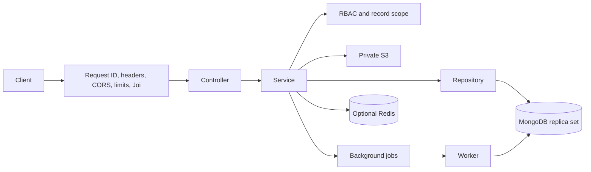

# Architecture and decisions

Status: **Phases 1-9 are implemented** after user approval. Production tooling and live acceptance boundaries are in PHASE9.md. Reporting policies and evidence boundaries are in PHASE6.md. Attendance and private photo details are in PHASE4.md.

## System boundaries

Phase 9 shares atomic fixed-window HTTP/auth quotas through MongoDB request_limits, with HMAC client keys and TTL cleanup. ServiceRuntime separates HTTP lifecycle from process signal wiring for real-socket drain/startup/deadline tests. Restricted operational metrics authorize before and after bounded queue observations outside global write fences. DB telemetry logs only operation categories/durations; pool checkout waits are bounded. Additive index/preflight tooling inventories all runtime models. Dashboard completion/effective-time indexes are checked with real replica-set query plans. See PHASE9.md; dashboards retain live authorization and no shared result cache.

A modular monolith serves versioned REST APIs. Express controllers translate HTTP input/output; Joi validators produce validated DTOs; services implement business rules; repositories accept explicit authorization predicates and perform Mongoose queries. Controllers never construct arbitrary database filters. Shared authentication/scope services are the sole authority for access decisions. Bounded operational workers handle credentials, imports, exports and orphan cleanup; general reminders remain a future feature. UTC dates are persisted; business dates and reporting boundaries use Asia/Kolkata.

Phases 2-3 add identity/RBAC, role/policy administration, audited employee and hierarchy mutations, branches, location masters and an encrypted credential-delivery SMTP worker. Phase 4 adds attendance/file collections, private version-bound S3 evidence with AWS SDK v3 and orphan cleanup. Phase 5 adds csv-parse streaming, durable MongoDB import/export jobs, exact decimal lead calculations and revision-checked assignments/workflows. Redis remains deferred. Health is a real module with controller/service/routes. Reserved directories are marked with `.gitkeep`. Argon2id, jose JWT and Nodemailer are used for identity.

## Important decisions (GUIDE.md §25)

| # | Decision and recommended default | Alternative / consequence to approve before its phase |
|---|---|---|
| 1 | Custom roles use the same controlled permission registry and creation/reporting policies as system roles. Role codes are labels, never implicit access. | Separate custom-role hierarchies complicate authorization and are unnecessary. |
| 2 | `users.reportingManagerId` is the authoritative adjacency relationship; indexed `$graphLookup` retrieves downlines with a depth limit of 20. All manager mutations acquire an organization revision write in a transaction, then validate the graph. | Materialized ancestor paths speed reads but require transactional updates to entire descendant sets. Adopt only after measuring. |
| 3 | A permission grant couples action and scope. Multiple grants for an action form a union; validated client filters are intersected with that union using `$and`. | A global branch restriction would incorrectly prevent explicitly authorized cross-branch supervision. |
| 4 | BH receives BRANCH scope for selected actions. REPORTING_SUBTREE is independent and includes only descendants. Branch access never implies authority to create/assign arbitrary roles. | Restricting BH to descendants excludes branch peers; grant both scopes explicitly if desired. |
| 5 | One active role and one primary branch per employee initially. MD bootstrap is the only manager-less root; branch can be absent only for explicitly company-wide roles. | Multiple roles/branches need conflict rules and a membership collection; defer. |
| 6 | Load active user, session, and role grants on every authenticated request. JWT contains identity/session references, never trusted permission snapshots. No authorization caching initially. | Later cache by user/role/org revision with invalidation; revoke sessions on deactivation/password reset. |
| 7 | Attendance retains its capture branch and policy snapshot; future calls, visits and targets retain their attribution snapshots. Current hierarchy controls current access; immutable audit captures transfers and assignment changes. | Managers seeing all former employees' history risks leaks; historical reporting access requires a separate explicit policy. |
| 8 | Normalize Indian phone numbers to E.164; unique `(branchId,mobileNumber)` for customers. CSV duplicates are skipped and reported, never overwrite silently. Preview is staged; commit rechecks unique constraints. | Company-wide dedupe prevents branch duplicates but can expose customer existence across branches. |
| 9 | TC proposes a sales assignee by default. Direct assignment requires `leads:assign` and visibility of both lead and eligible active SEx. Manager approval resolves proposals. | Automatic assignment needs capacity/territory rules; do not invent them. |
| 10 | Authoritative server timestamps, checked client timestamp skew (recommended 5 minutes), valid GPS/accuracy, owned confirmed photo, optional branch geofence. Suspicious evidence enters review. | Browser evidence is spoofable; hardware attestation would require a separate product decision. |
| 11 | Targets count deduplicated verified call/visit/conversion events inside `[startDate,endDate)`; approved records only. Percentage can exceed 100%. Decimal sales values are computed server-side. | Client totals are easy to manipulate. Phase 6 uses explicit reviewer approval, preserved evidence and separate submitted/approved totals; independent telephony verification remains a future integration. |
| 12 | Minimal projections, private S3 with encryption, short signed URLs, authenticated data access, no PII in logs/caches/URLs, strict query allowlists. | Retention periods need legal/business approval; suggested defaults are in SECURITY.md. |
| 13 | Lead assignments use expected revision compare-and-swap in a transaction with append-only assignment history and audit; losers receive 409. | Last-writer-wins can silently redirect work. |
| 14 | Versioned lead-workflow configuration with a controlled status enum; normal edges documented in API_DOCUMENTATION.md. Terminal reopening requires explicit permission and reason. | Arbitrary admin-supplied executable rules are prohibited. Workflow revisions preserve event meaning. |
| 15 | All dashboard source pipelines begin with action-specific scope predicates before `$group`, `$facet`, sorting or pagination. | A dashboard permission alone must not reveal source data lacking read authorization. Cache keys include effective scope, org revision and filters. |

## Modules and ownership

| Module | Responsibility | Phase |
|---|---|---|
| health | Liveness and dependency readiness | 1 |
| auth | Login, sessions, reset/invitation tokens, logout | 2 |
| users, hierarchy | Employees, policies, transfers, graph checks | 2–3 |
| roles, permissions | Controlled registry, grants and delegation | 2 |
| branches, locations | Branches and validated location references | 3 |
| files | Private upload intents, confirmation, access, cleanup | 4 |
| attendance | Evidence, business dates, check-in/out, review | 4 |
| customers, csv-imports | Staged validated imports and calling assignment | 5 |
| leads, lead-assignments | Qualification, workflow, assignment history | 5 |
| telecaller-reports, sales-reports | Immutable activities and reviews | 6 |
| targets | Versioned targets and verified actuals | 7 |
| dashboards | Scoped aggregations, summaries and exports | 8 |
| activity-logs | Transactional append-only security/business events | 2 onward |
| notifications/reminders | Future general outbox-driven notifications; existing credential/import/export workers are implemented | Future |
| solar-projects | Documented installation/AMC boundary | Future |

## Transactions and background operations

MongoDB must run as a replica set. A transaction encloses sensitive writes and their audit/outbox events. The organization singleton revision serializes graph edits, preventing concurrent reciprocal manager changes. Role grants cannot exceed the actor's delegable capability; configuration updates use revisions. Lead conversion uses a unique source customer constraint plus idempotency keys. Long import jobs have bounded streaming batches, checkpoints, retry-safe unique row keys and progress state. Network calls to S3/email never occur inside a MongoDB transaction.

Use an outbox collection to atomically record notification/job intents beside business writes. Existing workers claim leased jobs with bounded retries and idempotent side effects; general reminders remain future work. Redis dashboard caching is optional and must not become the source of truth. Phase 9 production requires MongoDB shared HTTP/auth quotas before horizontal scaling.

## Unresolved business inputs

Confirm work schedules, grace periods, overnight attendance policy, GPS accuracy thresholds/geofences, report approval ownership, duplicate customer policy, target attribution after transfers, lead reassignment and reopening powers, approved panel/payment reference values, retention periods, notification provider, and permission delegation matrix before implementing the relevant phase. Recommended defaults keep inactive/unknown/unreviewed data out of verified performance totals. Location data must come from a vetted company/government dataset; no fabricated location seed is included.

## Runtime foundation

`createApp(config, dependencies)` has no network or environment side effects and is testable with injected readiness. `server.ts` validates environment, connects MongoDB, then binds HTTP. Readiness pings the database; liveness only indicates a running process. Startup fails closed if MongoDB is unavailable. SIGINT/SIGTERM stop accepting connections, drain requests, close MongoDB, and enforce a shutdown deadline. Operational errors expose stable codes, never stack traces or driver connection details.

Node 24 is the selected LTS line ([Node release schedule](https://nodejs.org/en/about/previous-releases)); update patches and container digests through deployment tooling. Express 5 is used ([migration reference](https://expressjs.com/en/guide/migrating-5/)); rejected async handlers reach centralized errors and validated queries stay in `res.locals` because request query is a getter.

Phase 2 operational bootstrap requires an empty employee collection and atomically creates the initial MD plus audit/invitation. Restricted invitation reissue handles expired setup links without opening registration or recreating the administrator.

## Phase 3 implementation decisions

OrganizationAccess takes the administration lock (shared with role/policy writes), then hierarchy revision, then locks/reloads the current actor/session/grants in a MongoDB transaction. Every employee/branch/location mutation uses this path. Graph validation and the final expected-revision update therefore cannot commit a reciprocal-cycle write skew. Read scopes are recomputed on every request; no hierarchy authorization cache exists.

Approved role-creation templates are a deliberate alternative to requiring every target action on the creator. For example, the documented BDO template can create MH employees whose ordinary import actions differ from BDO's actions. Both creator and target role revisions are captured when an administrator approves the policy; any role revision invalidates future uses until reapproved. Sensitive actions or company-wide ALL data access (except global reference-data read) additionally require permissions:delegate_sensitive ALL. Visibility alone does not permit editing an administrator or peer manager.

Destination authorization checks new manager and branch as well as source scope. Subtree/direct-report creators may use their own primary branch or branches already visible in their reporting set; a global administrator must make the initial assignment into a new branch. Relationship policies separately control manager-role eligibility and cross-branch edges. Branch-wide access never implies subtree membership. Branch-less employees require explicit allowsNoBranch on their role (seeded MD/BDO); that flag is sensitive administration.

Hierarchy lists are flat, paginated and depth bounded, with source users:read intersected with hierarchy:read. Mutations validate root connectivity, active ancestry and a maximum of 20 edges including existing descendant height. Transfers do not cascade branch updates to descendants or historical activity. They reject incompatible active child edges and assigned branch heads. Last-administrator protection uses effective core grants and active users/roles, not role names.

Location parent/code relationships are immutable through profile updates. Referenced masters cannot deactivate; branch location selection validates the complete active parent chain. The optional operational seed accepts at most 500 vetted records/5 MiB per file, preserves matching records and rolls back conflicts. No external location dataset is invented or downloaded.

## Implemented Phase 4 boundary

Attendance and photo attachment use the organization transaction fence, current actor/session/grants, expected revisions and atomic audit. S3 signing/inspection/deletion stays outside DB transactions. Parent attendance scopes authorize evidence review; generic file reads additionally enforce SELF/ALL file ownership. See PHASE4.md for configurable schedule/geofence defaults, evidence limitations and version-safe retention. General overnight shift schedules, holiday/absence/payroll inference and attached-evidence deletion are not configured.

## Implemented Phase 5 boundary

Customers/imports/leads share the organization fence with employee/role administration. Scoped repository predicates always precede list filtering/counts; canonical assignedTo drives current team/assigned work. Jobs persist initiating session identity and reauthorize creator/source, branch and recipient before publication/commit. Durable renewable MongoDB leases replace an external queue requirement for this phase. CSV parsing streams UTF-8 input with fixed limits and 50-row staging/commit transactions; only confirmed batches create live customers. Unique dedupe/source/idempotency constraints protect concurrent work. Exports are intentionally capped at 5000 rows/10 MiB and fail instead of truncating. Private file metadata is recorded before export writes to preserve orphan cleanup.

Requirements/prices use two-decimal input strings, BigInt multiplication with half-up INR rounding and Decimal128 persistence. Immutable lead workflow versions govern new leads; existing leads remain pinned. Receive-assignment capabilities separate caller/sales eligibility from generic report/read rights. No role name grants runtime access. Reference data and company duplicate policy are administrator-configured; no brand/payment data or verified calling/site activity is fabricated. See PHASE5.md.

## Phase 6 reporting implementation

A shared reports module implements the telecaller-reports and sales-reports HTTP namespaces, with thin routes, Joi DTOs, transactional services, a scoped read repository and injected private photo storage. A single typed report_activities collection stores CALL/VISIT records with server-owned attribution; report_history stores append-only revisions. Call durations derive from validated intervals; daily aggregation starts with source scope and groups original calls rather than saved summaries. Visits keep separate start/completion evidence and snapshots. Current canonical assignments authorize writes; report owner/branch snapshots and current hierarchy authorize history. See PHASE6.md for verification, time limits, atomic lead progression and retention policies.

## Phase 7 implementation

Targets use server-owned employee/branch attribution, canonical Kolkata half-open periods, exact Decimal128/BigInt values, scoped source/destination assignment and immutable definition revisions. The target repository computes approved report/milestone actuals with scope before count/sum; summaries group compatible branch/type/period/bounds and never add daily to monthly goals. New lead milestones capture pending evidence in the same source transaction; a unique lead/milestone retains first-event attribution and frozen conversion value across reopen/reassignment. Independent scoped review is required before these events count. Legacy capture derives attribution from original event/assignment revisions. Snapshot source grants preserve authorized historical credit without revealing current lead data. PHASE7.md records the default policies and alternatives; target analytics use current approvals and coherent transaction snapshots, without cached counters.

## Phase 8 implemented analytics

Shared capability-aware dashboard routes use fresh transactional snapshots, a centralized dashboard/source/export scope intersection, and MongoDB match-before-group aggregates. A SELF dashboard adapts employee ownership versus commercial creator/current assignment without role-name branches. Dedicated endpoints enforce source grants; overview reports unavailable sections. Verified milestone attribution and target actuals reuse Phase 7 semantics; current stock/funnel/cohort metrics are explicitly operational. Current-role breakdowns only label already-visible employees. Calendars are explicit per branch; provisional absence intersects active eligible staff and source scopes, and no historical employment calendar is invented. Private queued metric/value CSVs reauthorize before generation/publication/download and compare same-asOf fingerprints to reject stale or no-longer-authorized aggregates. No cache shares actor-dependent results. See PHASE8.md for policy decisions and bounded execution.
